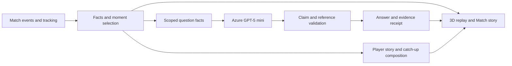

# Matchmind

**Your player. A clearer story. Evidence you can replay.**

Matchmind is a football companion that connects a 3D match replay, contextual questions, replayable evidence, and personal player stories. Choose a player, explore how an attack unfolded, inspect the supporting sequence, and catch up on the interval you missed.

[Inside the Game project](https://innovationstudio.microsoft.com/hackathons/insidethegamedeveloperhackathon/project/127234)

## Experience

- **Ask about a moment.** Player-statistics and completed-attack questions retain their original subject, viewing time, and explanation mode.
- **Inspect the evidence.** Open an answer's own evidence replay, inspect eligible movement observations, and return to the original context.
- **My Player Story.** Maintain several observed players and explore ordered chapters combining recorded actions, receiving links, movement observations, and related attacks. Replay chapters as a continuous sequence.
- **Personalised catch-up.** Step away and I’m back mark an actual interval. Catch me up prioritises the player you follow and links back to relevant moments.
- **Casual / Analyst.** Choose the depth of the next explanation while preserving the same underlying facts.

## Run locally

Use Node.js 22.13 or newer and npm. Install dependencies in this checkout; the application does not require another Matchmind workspace.

```sh
npm ci
npm run db:local
npm run dev
```

`npm ci` runs the preparation lifecycle: it verifies the 65 bundled public assets and generates the application shell and Worker inputs. `npm run prepare` can repeat that step explicitly. Open the development URL, normally `http://localhost:5173`. If prompted, use the existing local development sign-in at `/signin-with-chatgpt?return_to=/`.

Start the replay and pause near its beginning before choosing a player. Add the player to Observed players, close the story dialog, mark Step away, and play normally to approximately 00:20 before selecting I’m back and pausing.

Open the first completed attack, ask how it developed, and inspect the answer's evidence. Then open My Player Story and select Replay story. The exact available chapters and recap totals follow the current viewing time and marked interval.

Default local operation uses **Match facts**, without a cloud model call. The repository's Sites development sign-in is a controlled local fixture identity; it is not production Sign in with ChatGPT verification. The built Worker launched by `npm start` does not include this development sign-in middleware and returns 401 for anonymous protected API calls. Saved stories and shares in development require local database setup and that local identity. These conditions are documented separately from any hosted deployment.

## Build and check

```sh
npm test
npm run build
npm start
```

The test command explicitly selects 18 public, offline core test files. It does not run live-provider tools or the private development audit archive. `npm start` uses the locally built Worker and local Wrangler persistence.

The checked-in 3D runtime is included so the replay can run immediately. Its customised source and lockfile are also included. To rebuild it:

```sh
npm ci --prefix vendor/soccerviewer
npm run build:viewer
```

## Architecture



Azure-hosted GPT-5 mini deployed through Microsoft Foundry supports selected statistics and attack explanations. The server supplies scoped facts and checks model claims and references. Player stories and catch-up summaries use deterministic composition. The web/API implementation targets Cloudflare Workers, with D1 storing sessions, queries, evidence receipts, and saved stories.

Optional model configuration is documented in `backend/.env.example`. Credentials belong in the server runtime environment. The public checkout contains placeholders and no Azure resource credentials. Local Wrangler database identifiers are placeholders, and `db:local` acts only on local persistence.

## Source map

- `app/`, `worker/`, `lib/`: web entrypoints, API, identity and persistence integration.
- `backend/`, `prompts/`: facts, provider requests, validation and explanation contracts.
- `public/`: interface, match assets and the current 3D runtime.
- `vendor/soccerviewer/`: customised 3D viewer source and its dependency lockfile.
- `drizzle/`: database migrations.
- `scripts/`, `build-support/`: self-contained preparation, asset checks and local build configuration.
- `tests/`: selected offline checks and their public fixtures.

## Data and current scope

The sample replays a historical match with fictional team names. Answers stay tied to their match time and evidence; movement observations and estimates are labelled accordingly. See [data and technical notes](docs/data-and-scope.md).

## Credits

Our 3D replay builds on [soccerviewer](https://github.com/andrewRowlinson/soccerviewer) by Andrew Rowlinson. Matchmind adds contextual AI explanations, answer-linked evidence, personal player stories and personalised catch-up. The customised viewer source is included in `vendor/soccerviewer/`.

## Licences

Third-party notices and applicable licences are retained in [THIRD_PARTY_NOTICES.md](THIRD_PARTY_NOTICES.md), the data notice and the viewer directories. Upstream copyright and licence files apply to their respective components. This repository does not relabel every component under one new licence.
